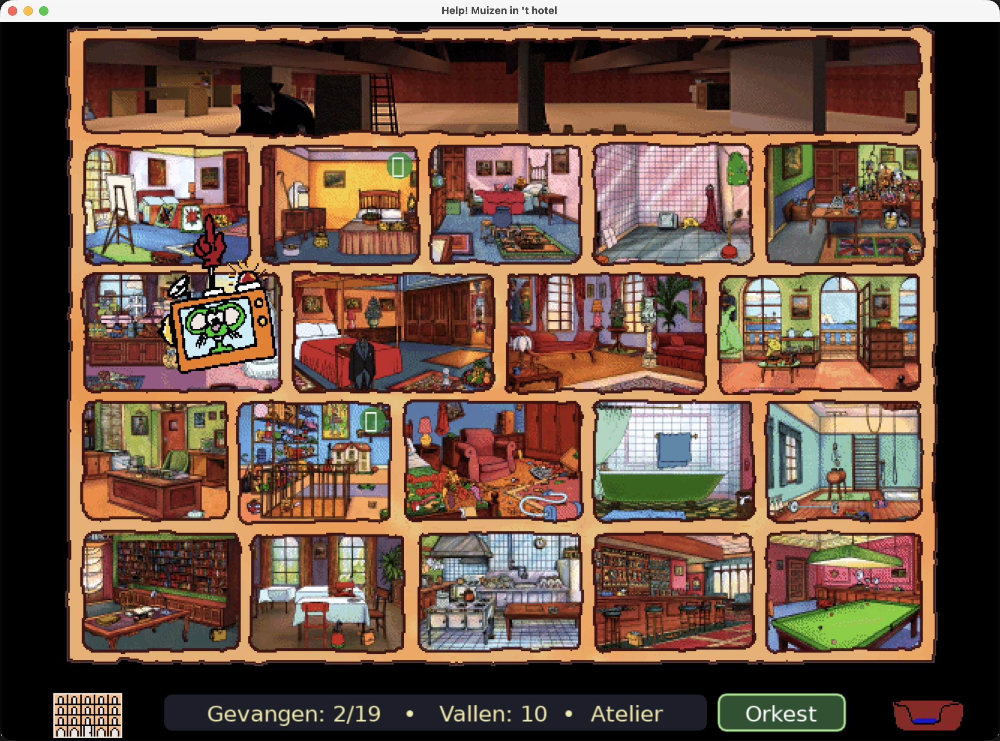
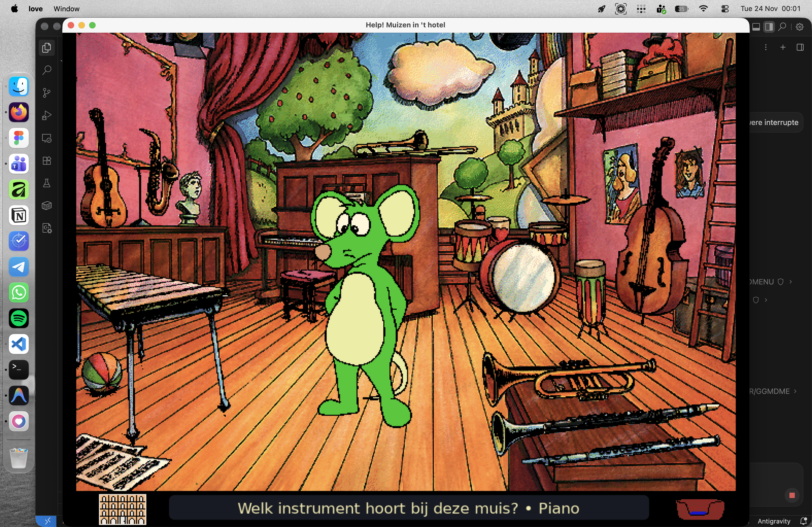

# Help! Muizen in 't hotel (Open-Source LÖVE Reimplementation)

An independent, clean-room, open-source reimplementation of the classic 1996 Dutch PC/Mac CD-ROM game **"Help! Muizen in 't hotel"** (Dutch localization of *The Great Green Mouse Disaster*, originally built in Macromedia Director 4), written in Lua for **LÖVE 12.0** targeting **macOS/Desktop** and **Android tablets** (`love-android`).

---

## Screenshots

| Hotel Hub & Mouse-Detector TV | Backstage Instrument Matching |
| :---: | :---: |
|  |  |

---

## Legal & Copyright Disclaimer

* **No copyrighted assets are included in this repository.** Original `.DXR`, `.EXE`, `.MOV`, `.AIF`, `.WAV`, and `.BMP` files, as well as converted images, audio, video frames, `.love` archives, and `.apk` builds, are excluded via [.gitignore](.gitignore).
* **You must supply your own legal copy** of the original game and run the local conversion script to generate `assets/` on your machine.
* All code in `src/` and `tools/` is an independent clean-room implementation.

---

## Design Philosophy

* **Faithful yet modern:** Preserves the original `640×480` artwork, Director palettes/transparency, animations, QuickTime intro/room clips, sound effects, and gameplay flow while replacing 1990s Win16/QuickTime 2.0 limitations with crisp aspect-preserving scaling, safe-area support, reliable audio queuing, and unified mouse + touch controls.
* **Pure-Python asset extraction:** [tools/director.py](tools/director.py) decodes Macromedia Director 4 (`RIFX`/`XFIR` `MV93`) bitmaps, palettes, Macintosh `snd ` resources, score timelines, and projector movies directly, while [tools/convert_assets.py](tools/convert_assets.py) transcodes audio and `.MOV` cutscenes with `ffmpeg`.

---

## Prerequisites

* **LÖVE 12.0** (also tested on LÖVE 11.5 via `love.getVersion()` guard in [conf.lua](conf.lua))
* **Python 3** with **Pillow** (`pip install pillow`)
* **`ffmpeg` and `ffprobe`** on `PATH` (for converting `.AIF`/`.WAV` audio and `.MOV` Apple Graphics `smc` video)

---

## Preparing Your Original Copy (Hybrid CD-ROM Note)

The original 1996 CD-ROM is a **Toast 3.0 Hybrid Mac HFS + ISO 9660** image (`MUIZENCD`). Modern macOS often fails to mount the raw `.iso` (`Device not configured`) because Toast placed a legacy Apple Driver Descriptor Map (`ER`) and Apple Partition Map (`PM`) inside the first 32 KB pointing to a Classic `Apple_HFS` partition.

* **Mounting on modern macOS:** Copying the ISO 9660 volume span (`VolumeSpaceSize * 2048`) with the first `32768` bytes zeroed produces a standard mountable ISO 9660 image without modifying your original backup.
* **Extracting files:** When extracting from the ISO 9660 tree, skip ISO 9660 associated resource-fork entries (`flags & 0x04`) so they do not overwrite the data forks of `DUTHELP/*.MOV`, `DUTVIDEO/ENGINTRO.MOV`, and `MUIZEN.BMP`.

---

## Converting Local Assets

Run the multi-threaded asset converter against your extracted CD-ROM directory:

```bash
python3 tools/convert_assets.py --source <originele-map> --output assets
```

For example, if extracted into `backup/extracted`:

```bash
python3 tools/convert_assets.py --source backup/extracted --output assets
```

### Options

* `--source <dir>`: Path to the extracted original game files (case-insensitive lookup; default: `backup/extracted`).
* `--output <dir>`: Destination directory for converted `.png`, `.wav`, video frame sequences, `dxr/*/score.lua`, and `manifest.lua` (default: `assets`).
* `--workers <n>`: Number of parallel conversion threads (default: CPU count).
* `--skip-videos`: Skip `.MOV` frame/audio extraction for quick testing.
* `--video-quality <q>`: `ffmpeg` JPEG `q:v` quality (`2` = highest quality, `8` = smaller size; default: `4`).

### Asset Search Order

At startup, [src/core/assets.lua](src/core/assets.lua) looks for `manifest.lua` in this order:

1. Environment variable `MUIZEN_ASSETS_DIR`
2. Gitignored `local_config.lua` (`assets_dir = "..."`; see [local_config.example.lua](local_config.example.lua))
3. Project/bundled `assets/` via `love.filesystem`
4. LÖVE user save directory (`<save-dir>/assets/`), useful for side-loading on Android

If no assets are found, the game launches [src/states/missing_assets.lua](src/states/missing_assets.lua) with instructions, checked paths, and Retry (`R`) / Quit (`Esc`) actions.

---

## Running & Controls

Launch from the repository root:

```bash
love .
```

### Global & Touch Controls

| Input | Action |
| :--- | :--- |
| **Mouse (Desktop)** | Hover rooms on the Hotel Hub with the Mouse-Detector TV scanner; click hotzones, traps, and running mice |
| **Touch (Tablet)** | Tap a room once to scan it (`Tik nogmaals`), tap again to enter; single-tap room spots, traps, and mice; letterbox/bezel taps and secondary multi-touch fingers are ignored |
| **`F1`** | Toggle hotzone & virtual-coordinate debug overlay (in rooms/attic: `C` auto-catches the mouse, click/`Esc` skips caught animations/videos) |
| **`F2`** | Toggle `linear` / `nearest` canvas scaling filter |
| **`F11`** | Toggle fullscreen |
| **`Esc` / Android Back** | Context-aware back / close trap or hint / save-and-quit dialog |
| **`R`** | Retry asset loading (on Missing Assets screen) |

### Save & Resume

Progress is stored in `savegame.lua` inside LÖVE's save directory via automatic checkpoints (after catching a mouse, matching an instrument, or placing a mousetrap), on window focus loss/quit, and via the **Opslaan** button when exiting the Hotel Hub. Completed sessions clean up `savegame.lua` upon reaching the finale.

---

## Project Status & Roadmap

* **Milestone 1 (Implemented):**
  * Asset converter (`tools/director.py`, `tools/convert_assets.py`)
  * Core engine (`viewport`, `assets`, `audio_queue`, `cursor`, `hotzone`, `scene_manager`, `video_player`, `director_stage`, `confirm_dialog`, `save`)
  * Missing-assets screen, CD-ROM Launcher, Intro video (`engintro`), Options/Start Menu (`GGMDMENU`), and Hotel Hub with live Mouse-Detector TV scanner + Fat Lazy Cat hint video (`cathelp6`)
* **Milestone 2 (Implemented):**
  * All 20 interactive hotel rooms (`ATTIC.DXR` + 19 standard rooms) with Director FilmLoop rendering and active room queue
  * Hiding-spot animations, running-mouse catch mechanics with anti-double-tap catch lockout and custom hanging/move catch animation, mousetrap bag (`10`/`5`/`0` traps), and Fat Lazy Cat room hints
* **Milestone 3 (Implemented):**
  * Backstage instrument matching (`INSTRUM.DXR`) with intro voiceover lock and reject cooldown
  * Cumulative orchestra rehearsal (`ORCH.DXR` with randomized music build progression and skip lock), grand finale (`ENDSEQ.MOV`), and credits (`CREDITS.DXR`)
* **Milestone 4 (Implemented):**
  * Save/resume hardening: versioned deterministic serialization, session normalization, automatic progress checkpoints + quit/focus autosave, mid-instrument resume, cleanup after finale, and resume summary display
  * Touch/desktop edge-case tuning: focus-aware pause and ref-counted audio/video resume, multi-touch and bezel-margin guards, Android Back button support, touch scanner UX, trap-menu dismissal, and right-click skip guards
* **Milestone 5 (Implemented):**
  * **Het Muizendoolhof** (`src/states/doolhof.lua`): randomized 4-quadrant 25×25 maze (`DOOLHOF.EXE` assets) with BFS connectivity guarantee, 10 mice, 3 corner cheeses, porters/cats/guest enemies, commotion animations, keyboard/D-pad/swipe controls, and game-over summary
  * **Super Spel** (`src/states/super_hub.lua`, `src/states/super_room.lua`, `src/core/super_scores.lua`): fast arcade hotel mode across all 19 `SUPER/*.DXR` rooms with auto-animating hiding spots, premature-click penalties, shader-tinted blue decoy mice, room-to-room escape chases, and persistent Top 5 High Scores (`superscores.lua`)
  * **Android Packaging** (`scripts/build_android.sh`, `scripts/generate_android_icons.py`): `.love` / `--no-assets` bundler, `adb` side-loading helper, mipmap launcher icon generator, and `love-android` APK builder with `sensorLandscape` orientation lock

---

## Bonus Modes

* **Het Muizendoolhof:** Guide 10 green mice from the hole at top-left to any of the 3 corner cheeses and safely back while dodging porters, cats, and an angry guest. Steer with **Arrow keys / WASD**, the on-screen **D-pad**, or **touch/mouse swipes** (`P` pauses, `Esc` quits).
* **Super Spel:** Scan the hotel cross-section with the Mouse-Detector TV to find the active room. Inside, hiding places animate automatically—**do not click until a mouse runs out!** Catch green mice for `300 / 200 / 100 / 50` points (decreasing if the mouse escapes to neighboring rooms), ignore blue decoy mice (`-100`), and aim for the Top 5 High Scores board.

---

## Android Tablet Packaging

The engine is configured in [conf.lua](conf.lua) and [main.lua](main.lua) for Android tablets (`t.externalstorage = true`, `t.modules.touch = true`, fullscreen mobile launch, `love.window.getSafeArea()`, Android Back key handling, and touch-mode hover suppression).

Package with [scripts/build_android.sh](scripts/build_android.sh):

```bash
# 1. Build a self-contained .love archive (includes local assets/)
./scripts/build_android.sh

# 2. Or build a lightweight .love without copyrighted assets and push assets/ via adb
./scripts/build_android.sh --no-assets --push-assets

# 3. Build an APK using a local love-android checkout (sets sensorLandscape + launcher icons)
LOVE_ANDROID_DIR=/path/to/love-android ./scripts/build_android.sh --build-apk
```
